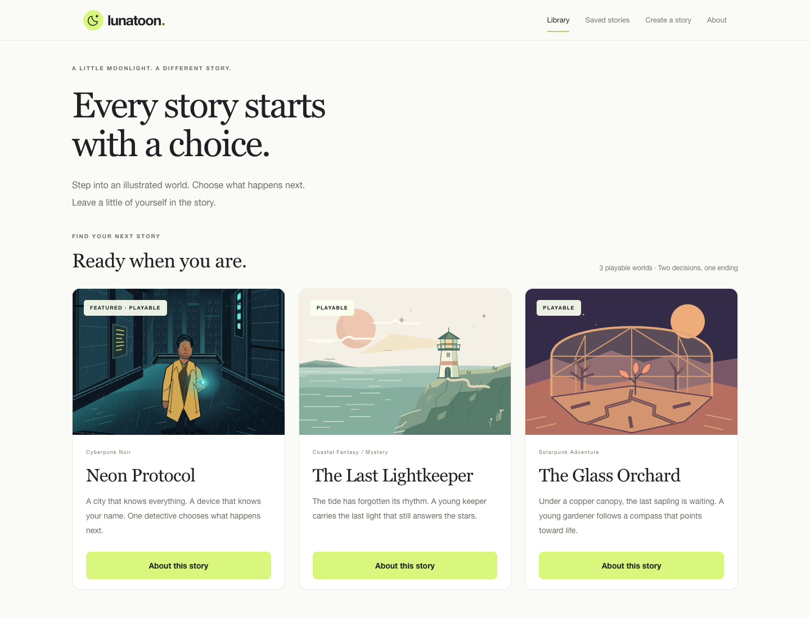

# Lunatoon

**Every story starts with a choice.**

Lunatoon is an AI-powered interactive webtoon application where readers shape illustrated stories through decisions and natural-language twists. Creator Studio turns an original premise into an editable story world, illustrated opening and playable experience.

Built for the **OpenAI DevDay Community Hackathon — Paris, October 2026**. English-language, desktop-first and local-first.



## Why Lunatoon?

Digital comics offer expressive visual storytelling, but their readers usually follow a fixed path. Building an illustrated story that responds to its audience adds writing, artwork and software work. Lunatoon explores a smaller, approachable loop: read an opening, make a meaningful choice, and see that choice become the next scene.

## Read a story. Make it yours.

**Choose a world → Read → Decide → Add a twist → Continue → Reach your ending**

Each story offers two decisions and four newly generated panels. Dialogue appears first; illustrations finish independently in a continuous reading strip. Saved choices, story facts, character details and visual references provide context for the next chapter.

| Playable world | Genre |
| --- | --- |
| **Neon Protocol** | Cyberpunk noir |
| **The Last Lightkeeper** | Coastal fantasy |
| **The Glass Orchard** | Solarpunk adventure |

Six additional original concepts are clearly marked **Coming soon**. They are previews, not playable stories.

## Create a world of your own

**Describe → Generate a foundation → Edit → Illustrate → Save a playable version → Play**

Describe an idea, then edit its premise, protagonist, visual direction, opening scenes and choices. Attach up to three owned visual references and explicitly label their roles, including the main character. **Save draft** keeps your work without image calls; **Save & Illustrate** generates the opening scenes. Once those scenes are saved, the story becomes playable in your local library.

Existing readings retain the exact story version and artwork they started with.

## What works today

- **Continuous reading:** illustrated openings, overlaid dialogue, integrated choices and a personalized ending.
- **Progressive artwork:** each final illustration appears when ready. Saved scenery provides clearly labeled atmosphere while waiting; genuine intermediate previews appear only when the provider supplies them.
- **Story memory:** structured narrative state and saved visual references guide continuity across both decisions.
- **Local persistence:** SQLite and local files preserve dialogue, choices and artwork across refreshes and application restarts.
- **Controlled recovery:** independent image retries, duplicate-request protection and visible usage, estimated costs and limits.
- **Portable endings:** download a completed story as self-contained HTML for offline reading.
- **Local content management:** resume readings, revisit completed stories, and delete readings or created stories with confirmation.

## Demo

Watch Lunatoon in action — from interactive reading to creating and playing an original illustrated story.

[](https://www.youtube.com/watch?v=Y_RcSYUp_AQ)

**[Watch the 2-minute demo on YouTube](https://www.youtube.com/watch?v=Y_RcSYUp_AQ)**

- **Hosted interactive demo:** not published. Run the application locally using the instructions below.
- **Screenshots:** [Library](docs/screenshots/hackathon-library.png) · [Reader](docs/screenshots/hackathon-reader.png) · [Creator Studio](docs/screenshots/hackathon-studio.png)

Screenshots show the actual interface with original bundled artwork in an isolated workspace, without uploaded references or generated panels. They are not live AI quality benchmarks. Historical live Neon Protocol runs and their limitations are documented in the [development archive](docs/archive/poc/README.md).

## Technology

| Layer | Implementation |
| --- | --- |
| Application | Next.js App Router, React, TypeScript |
| Narrative | OpenAI Responses API, official JavaScript SDK, strict Structured Outputs and Zod validation |
| Illustrations | OpenAI Images generation/editing with story-owned references |
| Persistence | Node.js `node:sqlite`, local image files and immutable story snapshots |
| Image processing | Sharp for validated uploads, authored assets and export |
| Verification | Vitest, Playwright, TypeScript and ESLint |

The configured defaults are **`gpt-4.1-mini`** for narrative and **`gpt-image-2.5-flare`** at **`low`** quality for illustrations. Model access depends on your OpenAI API project. Overrides must support the implemented request format; the app never silently substitutes a model or retries in another paid mode.

## Getting started

Use **Node.js 24.14.0** from [`.node-version`](.node-version), npm and an OpenAI API project with access to the configured models.

```sh
git clone https://github.com/NassAbd/lunatoon.git
cd lunatoon
npm ci
test -f .env.local || cp .env.example .env.local
```

Set `OPENAI_API_KEY` in `.env.local`, then start the application:

```sh
npm run dev
```

Open [http://127.0.0.1:3000](http://127.0.0.1:3000). This is a local development address, not a hosted demo. The interface can load without a key; live generation requires API credentials and can incur charges. Restart the server after changing environment settings.

Storage defaults to ignored `data/`. **Back up the entire data directory with the application stopped.** The app has no authentication and is intended for a local, single-user installation.

### Run the checks

```sh
npm run typecheck
npm run lint
npm test
npm run build
npx playwright install chromium
npm run test:e2e
npm run test:engine:build
npm run test:engine:e2e
```

The browser suites use mocks, not paid OpenAI requests. The persistent-engine suite starts an isolated production server and temporary database on port **3110**; keep that port free. An installed Google Chrome can be selected with `PLAYWRIGHT_CHANNEL=chrome` instead of downloading Chromium.

See the [development guide](docs/development.md) for configuration, test isolation, recovery, diagnostics and the separately opted-in legacy live experiment.

## How it is built

A story template captures its opening, choices, character bible, initial state and owned references. Starting a reading freezes that template into a persistent run. Each decision produces a strictly validated two-panel script and state update before separate image requests begin. Completed assets are saved locally; reloading reads them rather than generating them again.

Creator drafts have their own foundation and illustration accounting. Illustrated versions remain immutable, and existing readings keep their original version. Request claims, reservations and explicit retries isolate failures without repeating successful work.

Read more in the [engine architecture](docs/story-engine-architecture.md), [template architecture](docs/story-template-architecture.md), [Creator and content-management guide](docs/creator-content-management.md), [visual-reference notes](docs/POC_08_3_VISUAL_REFERENCES.md) and [API cost model](docs/api-cost-model.md). The [POC archive](docs/archive/poc/README.md) preserves the investigation and test history; [SPECS.md](SPECS.md) describes the broader product vision.

## Current limits

- Local storage only: no accounts, cloud synchronization or publicly hosted interactive sharing. HTML export is a portable reading copy.
- Stories currently use a short two-decision format.
- Image latency, narrative quality and visual consistency depend on the provider and prompt. Reference images help; they do not guarantee identical characters.
- Intermediate image previews are optional. Successful historical live streams sometimes delivered only final images.
- Application budgets are estimates and call-count safeguards, **not provider billing caps**. Unknown usage and retries can incur charges.
- Node's built-in SQLite API is experimental in the pinned Node 24.14.0 runtime.
- Automated tests use mocked providers. Historical live Neon journeys succeeded; the newer worlds and Creator flows do not have equivalent recorded live quality validation.

## Hackathon and future direction

Lunatoon was built for the OpenAI DevDay Community Hackathon in Paris, October 2026, to explore participatory visual storytelling. It is an independent project, with no claim of OpenAI endorsement or affiliation.

Possible next steps include longer branching stories, richer creation tools, stronger visual identity consistency and public publishing. These are future directions, not current features.
