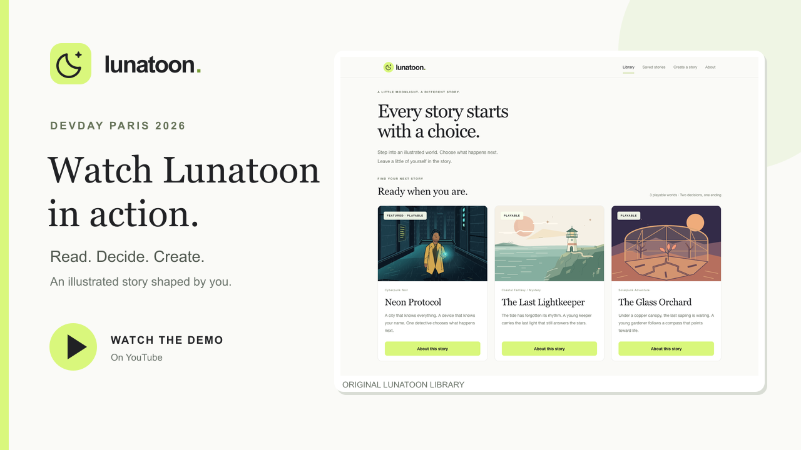

# Lunatoon

**Every story starts with a choice.**

AI-powered interactive webtoons where readers shape stories and creators bring their own worlds to life.

Built with Codex and the OpenAI API during the OpenAI DevDay Community Hackathon in Paris, October 2026.

[](https://www.youtube.com/watch?v=Y_RcSYUp_AQ)

**[Watch the 2-minute demo](https://www.youtube.com/watch?v=Y_RcSYUp_AQ)**

## What you can do

- **Explore three playable worlds:** *Neon Protocol* (cyberpunk noir), *The Last Lightkeeper* (coastal fantasy) and *The Glass Orchard* (solarpunk adventure). Six more concepts are marked Coming soon.
- **Shape the story:** make two decisions, add optional natural-language twists and see the consequences in AI-generated dialogue and illustrations.
- **Create a world:** use Creator Studio to describe and edit a story, attach up to three visual references, illustrate its opening and save a playable version.
- **Pick up where you left off:** local reading sessions keep choices, dialogue and artwork across refreshes and restarts.
- **Reach your own ending:** finish a short personalized story and export it as self-contained HTML for offline reading.

More screenshots: [Library](docs/screenshots/hackathon-library.png) · [Reader](docs/screenshots/hackathon-reader.png) · [Creator Studio](docs/screenshots/hackathon-studio.png).

## Tech stack

Next.js, React and TypeScript power the app. The official OpenAI JavaScript SDK calls the OpenAI API, using `gpt-4.1-mini` for narrative and `gpt-image-2.5-flare` for illustrations by default. SQLite stores local stories; Sharp handles images. Vitest and Playwright cover automated checks. **Codex helped develop the project; it is not a runtime dependency.**

## Getting started

Use [Node.js 24.14.0](.node-version) and npm:

```sh
git clone https://github.com/NassAbd/lunatoon.git
cd lunatoon
npm ci
test -f .env.local || cp .env.example .env.local
```

Set `OPENAI_API_KEY` in `.env.local`, then run:

```sh
npm run dev
```

Open [http://127.0.0.1:3000](http://127.0.0.1:3000). Live generation requires access to the configured OpenAI models and can incur API charges.

## Hackathon

Lunatoon was built over the hackathon weekend for the **OpenAI DevDay Community Hackathon — Paris, October 2026**. It is an independent project, without a claim of OpenAI endorsement or affiliation.

## Documentation

[Development guide](docs/development.md) · [Story engine architecture](docs/story-engine-architecture.md) · [Creator and content management](docs/creator-content-management.md) · [API cost model](docs/api-cost-model.md) · [Historical POC archive](docs/archive/poc/README.md)

## Current limits

Lunatoon runs locally; there is no hosted public demo. Stories use a short two-decision format. Image generation can take time, and visual consistency is not guaranteed.
