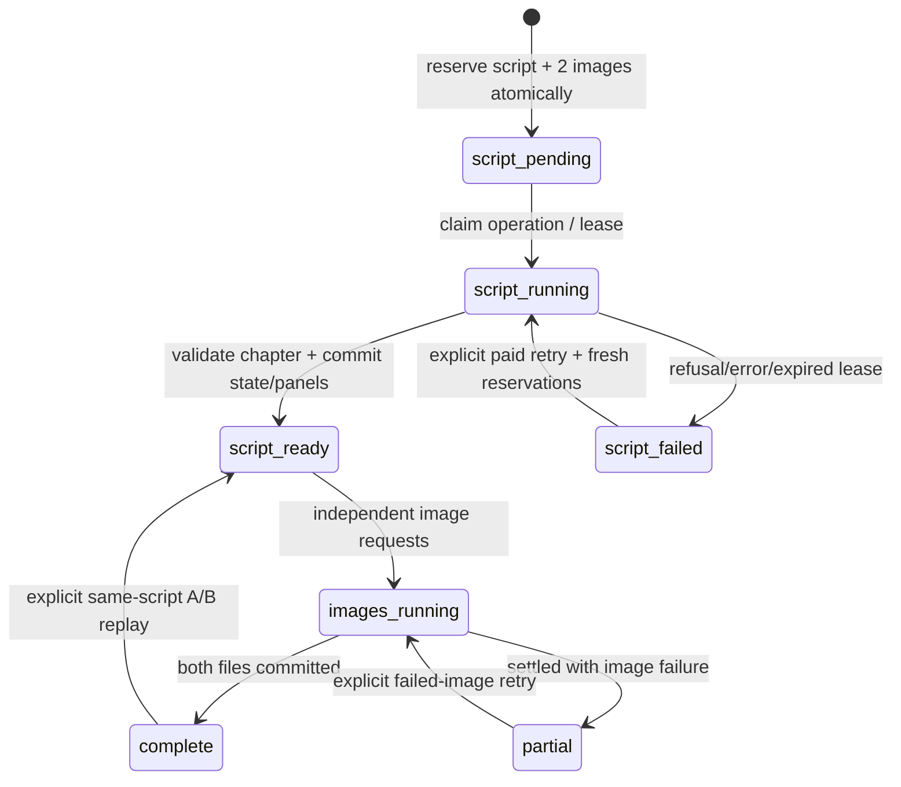

# POC 03 — local persistent story engine

Implemented on `feat/persistent-story-engine`, based on POC 02 commit `0ac736f3598b337201a1e8b532a26cd3ddf1d2b0`. The local branch and origin were verified equal before branching. No merge into main. `SPECS.md` remains the future product reference; this iteration adds one local, two-decision story, not a platform.

## Local setup and boundaries

Use the repository's Node **24.14.0** and `npm ci`. Set the server-only key in ignored `.env.local`, then `npm run dev`. On the original reader select A/text or B/reference and click **Start a persistent story**. Creating a run copies owned references and writes SQLite; it makes no generation calls. Bookmark `/run/<uuid>`. Explicitly select each decision to generate its two panels. The second decision ends the story. The original POC 02 reader, APIs, tests, dialogue overlays and A/B experiment remain available at `/`.

SQLite uses Node's built-in `node:sqlite`, SQLite 3.51.2 in the tested runtime. This avoids a native npm dependency or another service. **The API is experimental in Node 24.14.0** (release-candidate status starts in 24.15.0); keep the declared Node version for this demo. Reassess the runtime/API before broader use. No Docker or separate worker is necessary for this local experiment.

The app is single-user and local. It has no authentication and is bound to loopback by the npm scripts. Do not expose its generation endpoints or filesystem to a public network. POC 03 accounting applies to `/api/runs/...`; the preserved POC 02 experiment endpoints have their original behavior and are not part of a saved run's budget.

## Schema and durable records

Version 1 DDL is `src/lib/story-engine/schema.ts`; Zod boundaries are in `contracts.ts`. A fresh DB migrates in a transaction; a newer schema version is rejected rather than reset. There is no automatic destructive migration.

| Table | Data and constraints |
| --- | --- |
| `stories` | Immutable, content-addressed scenario/bible snapshot and reference metadata |
| `story_runs` | UUID, unique creation operation ID, story FK, current step/state, model/quality/mode and limit snapshots |
| `story_nodes` | Run FK, previous node, chosen option/twist, before/after state, chapter, status, error/timings; unique `(run, step)` and `(run, operation)` |
| `comic_panels` | Node FK, ordered script/dialogue, explicit scene + saved-appearance brief, status, current image path, metrics; unique `(node, sequence)` |
| `generation_events` | Planned reservation and every claimed call attempt, operation ID, stage, model/quality/mode, usage/cost/error, lease/claim, receipt path; unique `(run, operation)`; one planned/running event per stage/sequence |
| `replay_operations` | Unique run/operation, node and selected approach; idempotent same-script A/B reservations |

Records are JSON documents with relational IDs, FKs, unique constraints and SQL status columns. SQLite `STRICT` tables plus Zod reads/writes validate both relational keys and document shape. This is deliberately a small local model, not a generic story graph/ORM.

All mutations and budget checks use short synchronous `BEGIN IMMEDIATE` transactions, foreign keys, WAL and `synchronous=FULL`; busy timeout is five seconds. No network await occurs while holding the transaction. Independent server workers/connections therefore claim/reserve atomically. Duplicate operation IDs return saved status. Reusing a decision operation with a different payload is a conflict. Distinct submissions cannot create two nodes at the same step.

## Request-driven orchestration



Each image independently has `pending → running → complete|failed`. Node `script_ready` also represents unstarted reserved images; one successful sibling can display while another runs/fails. Failed images do not roll back validated dialogue/state. A later decision waits until existing requests have settled; a settled failed image does not prevent continuing the story.

No background task is launched after a Next.js response. `POST nodes` awaits and commits the narrative before returning. The browser commits dialogue, yields for paint, then starts **two concurrent separate image POSTs**. Each image request awaits its own provider and atomic disk/DB commit before responding. Polls and reloads only read/reconcile; mounting a page never submits paid work. Reserved but unstarted work has an explicit **Resume** control.

A four-minute persisted lease exceeds the SDK's three-minute timeout. A read after lease expiry marks an unresolved request interrupted, with unknown cost where usage is unavailable. There is no automatic retry. Before expiry, a restart may still display "running"; reload/status polling reconciles it at expiry. A fresh paid retry requires the user's action and another call slot. Claim tokens fence a late old response from overwriting a successful retry. Late usage can reconcile the old attempt's cost, without applying its story or replacing the newer image.

## Narrative and visual context

Every narrative request receives only this run's immutable bible, saved pre-decision state, selected saved option, optional twist, step limit, and up to four recent panel scripts/dialogues. Exactly two panels retain the strict legacy speech-bubble contract. Additional strict fields describe a concrete action/consequence, named source with evidence, bounded state updates, next options and ending flag.

Validation happens before any state changes: unique new fact IDs cannot replace old IDs; named source must be recorded in a new fact; later chapters cite at least two facts introduced after the opening; each next option cites two newly established facts. The final chapter has no further choices or unresolved threads. Character identity anchors and established object names are immutable. Injuries are additive; clothing/objects evolve explicitly; destroyed props cannot silently become intact. Object holders must agree with carried-object appearance records. Unknown IDs/holders, inconsistent state and invalid panel ordering/IDs are rejected atomically. Invalid output still consumes the recorded narrative attempt; no images start.

These are structural/identity protections, **not semantic proof** that generated dialogue truly depicts every claimed fact or is narratively excellent. The source/causality requirement is also prompted. Live human evaluation is still required; a model could introduce a contradiction under a different fact ID. No unmeasured quality rating is claimed.

Original Kael PNG, opening SVG, character/art guides and narrative reference are copied once per content hash into `data/references/`. Bible metadata stores MIME, purpose, relative path and SHA-256. Existing runs keep their snapshot when source documents change. Reference bytes are integrity-checked before use/serving. Device and station anchors are explicit; each stored panel brief combines its own beat/staging with saved characters/appearance/objects. Image generation uses the node's saved after-state, not a newer node's state. This compact experiment treats appearance updates as applying to the continuation's pair; it does not model within-panel timestamps.

A and B retain the POC 02 SDK endpoints: text generation versus multipart edit with the **same owned original sheet** for each independent call. Neither depends on the previous generated panel. Reference mode only accepts the documented model allowlist, never silently falls back. Model access errors remain stage errors. Same-script replay explicitly reserves two image calls, preserves dialogue/state, and retains older local images/event metadata. It replaces the displayed pair; the UI does not add a comparison library.

## Files, serving, and recovery

```text
data/                          # ignored; override via LUNATOON_DATA_DIR
  stories.sqlite               # plus SQLite WAL/SHM during operation
  references/<sha256>.png|svg|md
  images/<run-uuid>/<event-uuid>.jpg
```

Only relative paths are stored. Asset routes resolve a known reference ID or panel ID owned by the requested run. No user-supplied filesystem path or external image URL is accepted. Whitelisted path forms, realpath boundary checks, run ownership and reference hashes block traversal and symlink escapes. Responses use private/no-store, nosniff and sandbox CSP. Source references are original repository assets; generated images/data/test artifacts are ignored by Git.

Image receipt (usage and intended path) is committed before file IO; bytes are checked for bounded JPEG signature, written to an exclusive temporary file, fsynced, atomically renamed and parent directory fsynced. The panel path and completed event are committed afterwards. This is not a distributed filesystem/DB transaction, so recovery handles the gap:

| Interruption | Recovery on read; no paid work |
| --- | --- |
| Before claiming | Remains planned; explicit resume uses the same operation |
| Provider still running or process died | Wait for lease, then mark interrupted; retain unknown-cost reservation |
| Usage receipt saved, file absent | After lease: failed/interrupted; known usage retained; explicit image retry only |
| JPEG renamed, panel transaction absent | After lease: attach valid saved JPEG from receipt, mark complete |
| Panel/image complete | Reload serves existing dialogue/files; zero generation calls |
| Completed file missing/invalid | Mark that panel failed; restore backup or explicitly retry; no regeneration on refresh |
| Reference changed/missing | Refuse generation/serving; restore the immutable reference from backup |

JPEG validation checks size and marker bounds, not full raster decoding or a cryptographic checksum. Database corruption or disk failure requires a backup; there is no automatic reset, cleanup or database repair. Orphan files from interrupted writes/replays can remain, never billed again by loading them. Stop the app before backing up the **whole** data directory (including needed WAL), and preserve it when reinstalling/upgrading. Restarting alone does not delete it. Browser integration tests use isolated temporary data and clean up only their own directory/process.

## API summary

| Endpoint | Effect |
| --- | --- |
| `POST /api/runs` | Idempotent create, no paid call |
| `GET /api/runs/:run` | Snapshot/recovery, no paid call |
| `POST .../:run/nodes` | Atomically reserve continuation; await its narrative |
| `POST .../nodes/:node/script` | Resume planned operation or explicit failed-script retry |
| `POST .../panels/:panel/image` | Claim/await just one reserved image or explicit failed-image retry |
| `POST .../nodes/:node/replay` | Idempotent two-image same-script reservation, selected A/B mode |
| `GET .../assets/:asset` | Serve a DB-known local asset; no generation |

Mutation bodies are bounded/validated and reject a mismatched Origin. Operation UUIDs persist in DB. The client retains a transport retry's operation ID and serializes status reads so simultaneous completions do not roll back the visible snapshot. An application response is not an assertion that an unknown provider request was free.

## Verification and references

See `POC_03_RESULTS.md` for executed checks, and `api-cost-model.md` for budget semantics. Official references checked 2026-10-24: [Structured Outputs](https://developers.openai.com/api/docs/guides/structured-outputs), [Image generation](https://developers.openai.com/api/docs/guides/image-generation), [Node 24 SQLite documentation](https://nodejs.org/download/release/latest-v24.x/docs/api/sqlite.html). The shorter `https://nodejs.org/docs/latest-v24.x/api/sqlite.html` fetch failed; the official download documentation URL succeeded. Next route handlers, promised dynamic params and distDir were checked in installed `next/dist/docs`. No undocumented streaming/image-reference feature is assumed.
